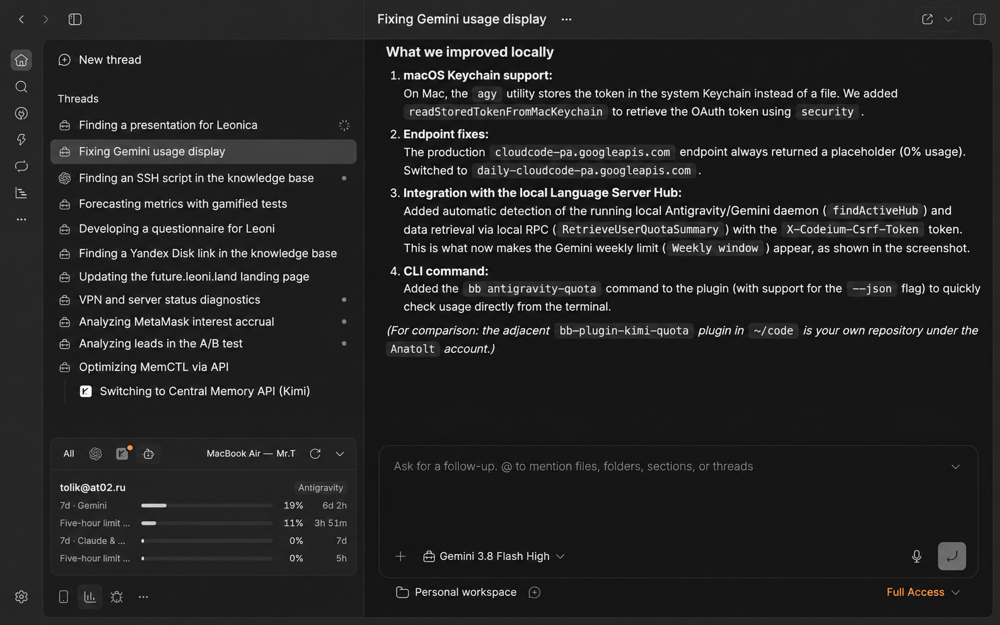

# Antigravity Usage for BB

Adds Antigravity and Gemini quota windows (weekly and 5-hour smoothing limits) to BB's Provider Usage panel.



## Requirements

- BB 0.43 or newer.
- An existing, working Antigravity ACP provider (`acp-antigravity`). This project does **not** install or replace an ACP provider.
- A local Antigravity installation / login:
  - **macOS**: Automatically retrieves credentials from macOS Keychain (`gemini:antigravity`) or connects directly to the local Antigravity Language Server Hub daemon.
  - **Windows**: Automatically reads the token from Windows Credential Manager (`gemini:antigravity`).
  - **Linux / file fallback**: Reads `~/.gemini/antigravity-cli/antigravity-oauth-token` (or override path with `ANTIGRAVITY_TOKEN_PATH`).

## Features

- **Live Quota Windows**: Displays both Gemini models (weekly limit and 5-hour window) and 3rd-party models (Claude & GPT weekly and 5-hour limits).
- **Local Hub Integration**: Connects to the active local Language Server daemon hub (`~/.gemini/antigravity/daemon/hub_*.json`) when available, providing instant zero-latency quota updates matching the desktop app.
- **Fallback to Cloud Code API**: If the desktop client is closed, falls back to `daily-cloudcode-pa.googleapis.com` where active quotas are served.
- **CLI Command**: Inspect quotas directly from the terminal:
  ```sh
  bb antigravity-quota
  # Or output raw JSON:
  bb antigravity-quota --json
  ```

## Privacy and credentials

The plugin reads the local login token only to make the quota request. It does not log, display, or persist access or refresh tokens. If the access token is expired, it asks the locally installed `agy` CLI to refresh it by listing available models; this does not start an inference turn. As a fallback, an OAuth client secret may be supplied through `ANTIGRAVITY_OAUTH_CLIENT_SECRET`; the plugin contains no embedded OAuth secret.

## Install

```sh
bb plugin install git:https://github.com/defacid/bb-antigravity-usage.git
```
